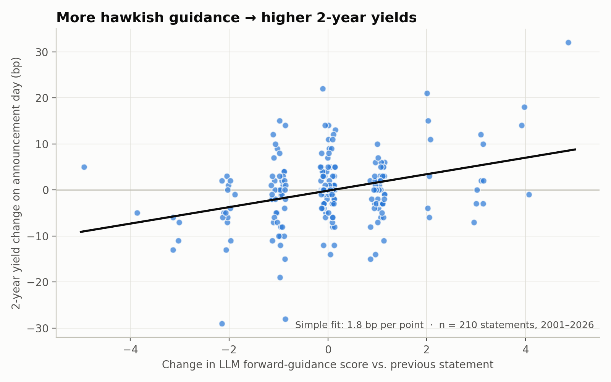
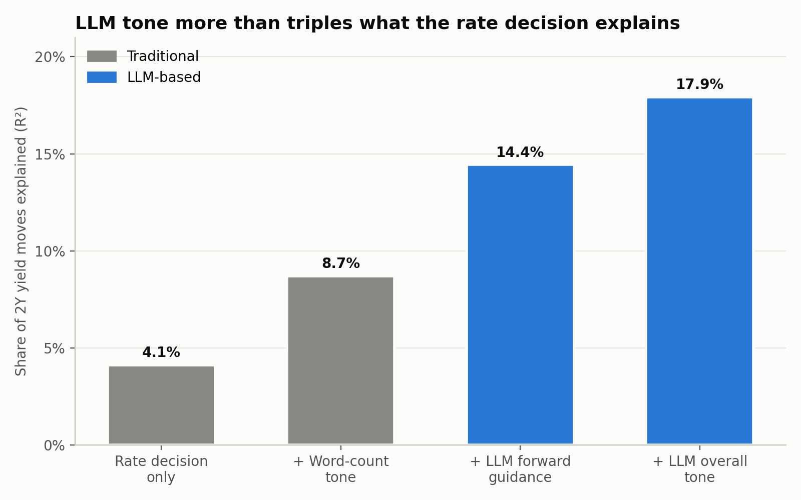
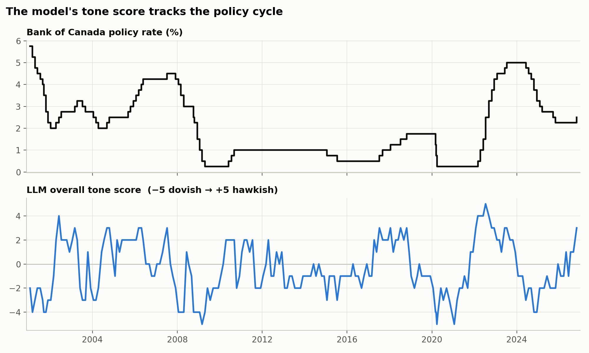

# Does the Bank of Canada's Tone Move Bond Yields?

**An LLM-based analysis of 211 Bank of Canada rate statements, 2001–2026**

*Cole Korchinski · Ivey Business School, HBA '28*

---

## Key findings

- **Forward-guidance tone moves the 2-year yield beyond the rate decision itself.** Each 1-point hawkish shift in the LLM's forward-guidance score moves the 2Y Government of Canada yield up **~1.75 bp** on announcement day (p < 0.001), holding the rate decision constant.
- **Tone more than triples what the decision explains.** The rate decision alone explains **4.1%** of announcement-day 2Y moves. Adding LLM forward-guidance tone raises this to **14.4%**, and overall tone to **17.9%**.
- **The LLM captures ~2.2x the signal of a traditional word-count method** (incremental R² of 0.103 vs. 0.046).
- **At the 5-year point, the decision doesn't matter at all (p = 0.98), but guidance does (p < 0.001).** Decisions affect the near term; guidance shapes where markets expect rates to go.
- **Results hold when excluding the 2008–09 and 2020 crises,** and when statements are **blinded** (dates, names and event references removed) to test for LLM lookahead bias.

---

## Method

1. **Data collection.** Scraped every rate statement from the Bank of Canada website (Python, `requests`, `BeautifulSoup`, `trafilatura`). Three unscheduled emergency statements missing from the BoC's listing page (Oct 8, 2008; Mar 13 and Mar 27, 2020) were identified through data validation and added manually.
2. **Market data.** Daily 2Y and 5Y benchmark yields and the policy rate from the Bank of Canada Valet API. Pre-2009 policy rates were parsed from statement text and validated against headline direction (0 mismatches).
3. **LLM scoring.** Each statement was scored by Claude (Anthropic API) on a calibrated −5 (dovish) to +5 (hawkish) rubric across four dimensions: rate path / forward guidance, inflation concern, growth outlook and overall tone. The rubric instructs the model to judge only the text, not later outcomes.
4. **Analysis.** Since markets largely anticipate both decisions and tone, the test uses the **change** in tone versus the previous statement. OLS regression of the announcement-day yield change on the rate decision (bp) and tone change, with heteroskedasticity-robust (HC1) standard errors.

---

## Results

**2Y yield change (bp) on announcement day, n = 210**

| Model | Effect of a 1 SD tone shift | p-value | R² |
|---|---|---|---|
| Rate decision only | n/a | n/a | 0.041 |
| + Word-count tone (baseline) | 1.62 bp | <0.001 | 0.087 |
| + LLM forward guidance | 2.42 bp | <0.001 | 0.144 |
| + LLM overall tone | 2.83 bp | <0.001 | 0.179 |

*Tone measures are standardized (1 SD) so the methods can be compared directly. In raw LLM units, each 1-point shift moves the 2Y by 1.75 bp (guidance) and 2.03 bp (overall).*

**Robustness: forward-guidance coefficient (bp per 1-point shift)**

| Test | Coefficient | p-value | R² added |
|---|---|---|---|
| Full sample | 1.75 | <0.001 | 0.103 |
| Excluding Mar–Apr 2020 | 1.73 | <0.001 | n/a |
| Excluding 2008–09 and 2020 | 1.72 | 0.001 | 0.100 |
| Blinded statements, full sample | 1.71 | <0.001 | 0.103 |
| Blinded statements, excluding crises | 1.75 | <0.001 | 0.107 |

**Economic size:** a typical (1 SD) shift in forward guidance moves the 2Y by ~2.4 bp. That is close to half of the average absolute 2Y move on announcement days (5.2 bp), which are themselves ~58% more volatile than normal days (3.3 bp).

---

## Notable statements

- **June 10, 2008 (+32 bp).** The largest hawkish shift in the sample. The BoC held at 3% when economists unanimously expected a cut; the model scored it as a +5 guidance shift.
- **September 7, 2011 (+5 bp despite a −5 dovish shift).** The BoC dropped its talk of rate hikes, which the model correctly read as very dovish. Yields still rose because markets had expected an even more dovish message. This illustrates the main limitation below.

---

## Limitations

- **Expectations aren't measured.** The model scores what a statement says, not how it compares with what markets expected. Adding a measure of market expectations is the natural extension.
- **Daily data.** Announcement-day moves also capture other same-day news (e.g., U.S. data releases). Intraday data would isolate the reaction more precisely.
- **Lookahead bias is reduced, not eliminated.** Blinding removes dates, names and event labels, but famous statements (e.g., March 2020) remain identifiable from context. The result holding outside crisis periods, where blinding is most effective, is the stronger evidence.
- **LLM scores vary slightly between runs** (0.95 correlation between original and blinded passes).
- The Oct 8, 2008 statement was a joint release with five other central banks, so its text includes non-BoC content.

---

## Related work

Gürkaynak, Sack & Swanson (2005), *"Do Actions Speak Louder Than Words? The Response of Asset Prices to Monetary Policy Actions and Statements,"* found that FOMC statements explain a large share of Treasury yield responses. This project tests a similar question for Canada, using an LLM to measure tone.

---

## Repository contents

| File | Description |
|---|---|
| `boc_sentiment_project.ipynb` | Full pipeline: scraping, scoring, analysis, charts |
| `master.csv` | Final dataset: one row per statement with scores, rate changes and yield moves |
| `boc_statements.csv` | Raw statement text |
| `scores_run1.csv`, `scores_added.csv`, `scores_blind.csv` | LLM scores (original and blinded) |
| `chart*.png` | Figures |

**Tools:** Python, pandas, statsmodels, matplotlib, BeautifulSoup, trafilatura, Anthropic API, Bank of Canada Valet API
